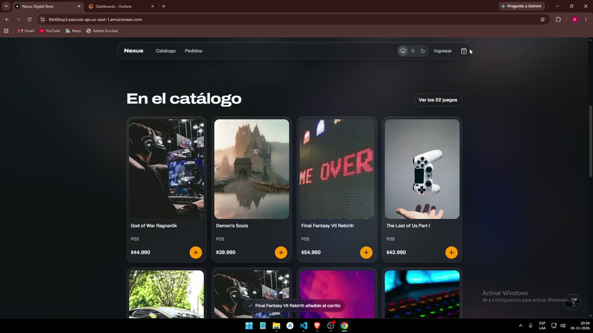
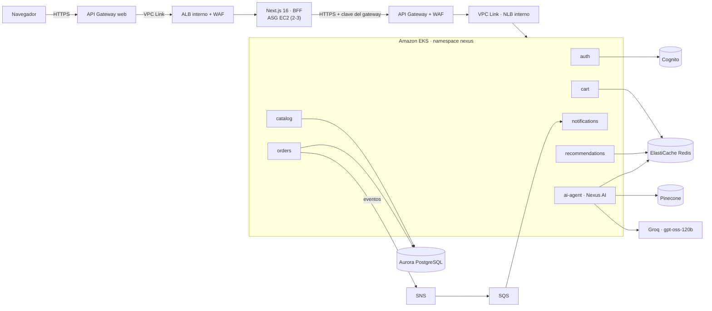
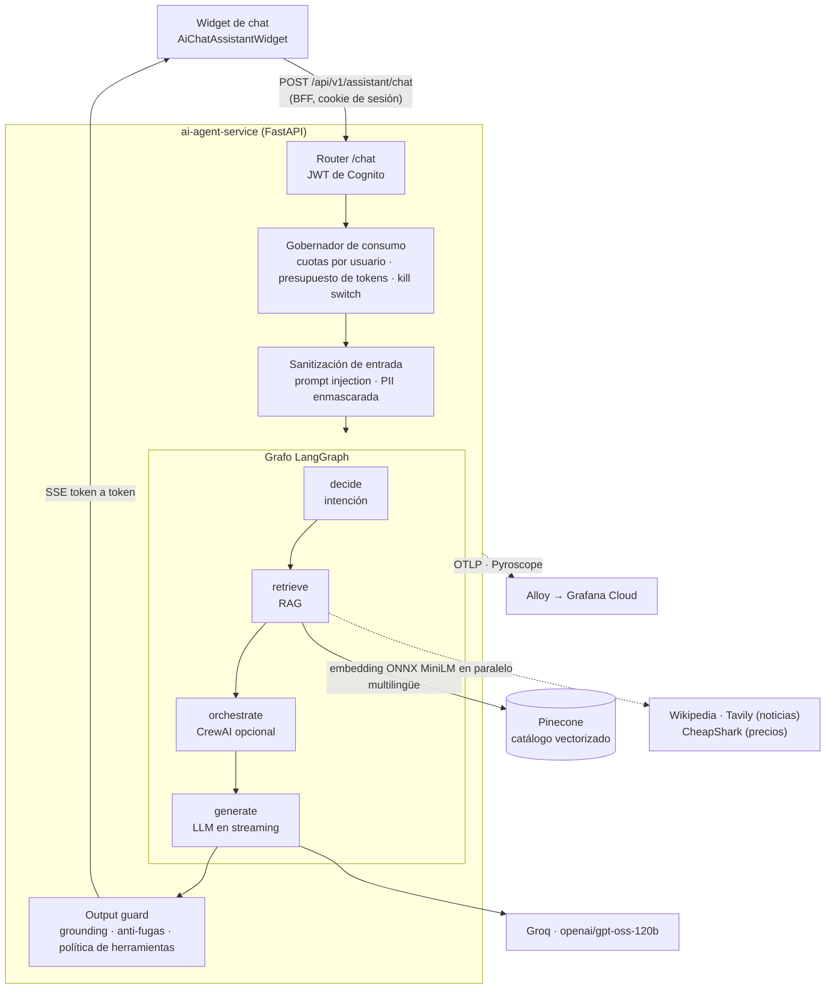
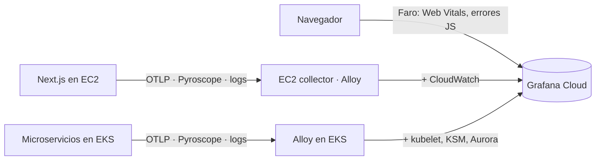

# Nexus Digital Store

Tienda de videojuegos en línea con un **asistente de IA conversacional** que recomienda juegos del catálogo, compara precios y responde dudas en tiempo real. Este repositorio contiene el **frontend** (Next.js 16 + React 19), que también actúa como **BFF** (*Backend for Frontend*) entre el navegador y los microservicios.

| Repositorio | Contenido |
|---|---|
| **nexus-frontend** (este) | Tienda, panel de administración, BFF seguro, observabilidad del navegador y del servidor |
| [nexus-backend](https://github.com/BeoGonzalez/nexus-backend) | 7 microservicios FastAPI en EKS, incluido el asistente **Nexus AI** |
| nexus-infrastructure | Terraform + Kubernetes + Alloy (AWS Academy Learner Lab) |

## Demo

[](docs/demo/nexus-demo.mp4)

> Haz clic en la imagen para ver la demo completa de la aplicación desplegada en AWS (6 min, 720p).

<!--
  Reproductor dentro del README: en GitHub, edita este archivo en la web, arrastra nexus-demo-github.mp4
  (versión de menos de 10 MB) justo debajo de esta línea y guarda. GitHub sustituye el archivo por una URL
  https://github.com/user-attachments/assets/... que se muestra como reproductor de video.
-->

## Funcionalidades

- **Catálogo** con filtros y fichas de juego con portada 3D (React Three Fiber).
- **Cuentas con AWS Cognito**: registro con confirmación de contraseña (sin código de verificación), login, recuperación de contraseña y sesión en cookies `HttpOnly`.
- **Carrito y checkout** para invitados y usuarios registrados; historial de **pedidos**.
- **Panel de administración** (grupo `admins` de Cognito): juegos, stock, usuarios y ajustes.
- **Nexus AI**: asistente en streaming que recomienda juegos del catálogo con stock y precio real en CLP.
- **Observabilidad completa** en Grafana Cloud: Web Vitals (Faro), trazas OpenTelemetry, perfiles Pyroscope y logs.

## Arquitectura general



- El **navegador nunca habla con los microservicios**: todo pasa por el BFF de Next.js (`src/app/api/v1/*`), que valida cada cuerpo con Zod, aplica listas blancas de rutas y añade la clave del API Gateway del lado del servidor.
- Los **JWT de Cognito viven solo en cookies `HttpOnly`**; el JavaScript del navegador nunca ve un token.
- Cada microservicio **vuelve a validar el JWT** (RS256 contra el JWKS del User Pool).
- Infraestructura en **AWS Academy Learner Lab**: VPC con 5 capas de subred en 2 AZ, datos sin salida a Internet, KMS, Secrets Manager y WAF.

## Arquitectura de Nexus AI

El asistente es el servicio `ai-agent` del backend (FastAPI + LangGraph). Recibe la pregunta del usuario, recupera juegos reales del catálogo por similitud semántica, la enriquece con fuentes externas y genera la respuesta en streaming con un LLM de Groq. Pasa por varias capas de seguridad antes y después de llamar al modelo.



| Etapa | Qué hace |
|---|---|
| **decide** | Clasifica la intención (recomendación, saludo, soporte, stock/precio, enviar correo). |
| **retrieve** | Genera el embedding de la consulta (`paraphrase-multilingual-MiniLM-L12-v2`, ONNX cuantizado, revisión fijada) y busca los juegos más parecidos en **Pinecone**, con precio en CLP y stock. Consulta **Wikipedia**, **Tavily** y **CheapShark** en paralelo. |
| **orchestrate** | Análisis multiagente con **CrewAI** (desactivado por defecto con `ENABLE_CREWAI_ORCHESTRATION=false`). |
| **generate** | Cadena LCEL de LangChain con **Groq** (`openai/gpt-oss-120b`, razonamiento `low`) y respuesta en *streaming*. |

**Seguridad del LLM (OWASP Top 10 for LLM / Agentic):**

- **LLM01 Prompt injection:** sanitización de entrada, *system prompt* aislado e historial saneado.
- **LLM02 Fuga de datos:** enmascarado de PII y un *output guard* en streaming que corta respuestas con secretos o datos sensibles.
- **LLM03 Cadena de suministro:** modelo de embeddings fijado por commit de HuggingFace e incluido en la imagen.
- **LLM06 Consumo sin límite:** peticiones por minuto y por día, streams concurrentes, tope diario de tokens y *kill switch* (`ASSISTANT_ENABLED`).
- **LLM09 Desinformación:** *grounding*: solo recomienda juegos que existen en el catálogo, con su stock real.
- **Herramientas:** el envío de correo pasa por una política explícita (`EmailToolPolicy`).

**Métricas del modelo** (OpenTelemetry → Grafana Cloud): `nexus_llm_tokens_total`, `nexus_llm_requests_total{outcome,intent}`, `nexus_llm_request_duration_seconds`, `nexus_llm_rag_results`, `nexus_llm_quota_rejections_total` y `nexus_llm_security_events_total`. Se ven en el dashboard **Nexus · Modelo de IA**.

## Stack del frontend

| Área | Tecnología |
|---|---|
| Framework | Next.js 16 (App Router, `output: standalone`), React 19, TypeScript |
| UI | Tailwind CSS 4, Radix UI, lucide-react, React Three Fiber + drei (3D) |
| Datos | TanStack Query 5, Zod 4 (validación en el BFF) |
| Autenticación | AWS Cognito vía `auth-service`; sesión en cookies `HttpOnly` |
| Observabilidad | `@vercel/otel` (trazas), `@pyroscope/nodejs` (perfiles), Grafana Faro (navegador) |
| Pruebas | Vitest + Testing Library; pruebas de integración del BFF |

Estructura (arquitectura por capas):

```
src/
├── app/              rutas (store, login, recuperar, admin) y BFF en app/api/v1/*
├── application/      hooks de casos de uso (TanStack Query)
├── domain/           modelos y contratos
├── infrastructure/   BFF (proxy a servicios, cookies, logs de seguridad), API client, observabilidad
├── presentation/     componentes, chat del asistente, 3D, tema
└── proxy.ts          CSP con nonce, cabeceras de seguridad y protección de rutas
```

## Ejecutar en local

Requisitos: Node 22 y pnpm 10.

```bash
pnpm install --frozen-lockfile
cp .env.example .env.local      # completa los IDs de Cognito y las URLs de los servicios
pnpm dev                        # http://localhost:3000
```

| Comando | Descripción |
|---|---|
| `pnpm test:run` | Pruebas unitarias (Vitest) |
| `pnpm test:integration` | Pruebas de integración del BFF |
| `pnpm typecheck` · `pnpm lint` | TypeScript y ESLint |
| `pnpm build` | Build de producción |
| `pnpm check:bundle-secrets` | Verifica que ningún secreto del servidor llegue al bundle del navegador |

## CI/CD (DevSecOps)

`.github/workflows/devsecops-frontend.yml`, alineado con OWASP Top 10:2025:

1. **Gitleaks** sobre todo el historial.
2. **Calidad:** lockfile congelado, `pnpm audit --prod`, ESLint, `tsc`, Vitest, build y chequeo de secretos en el bundle.
3. **Semgrep** (SAST para TypeScript, React y Next.js) y **Hadolint** (Dockerfile).
4. **Imagen** distroless sin root → **Trivy** (falla en HIGH/CRITICAL corregibles) → **SBOM CycloneDX**.
5. **Solo en `main`:** push a **ECR** con tag inmutable (SHA del commit), firma **Cosign keyless** y procedencia **SLSA**.

Variables del repo (*Settings → Secrets and variables → Actions*): `AWS_ACCOUNT_ID`, `AWS_REGION`, `ECR_REPOSITORY_FRONTEND`, `NEXT_PUBLIC_AWS_REGION`, `NEXT_PUBLIC_IMAGE_HOSTS`, `NEXT_PUBLIC_FARO_URL`. Secrets: `AWS_ACCESS_KEY_ID`, `AWS_SECRET_ACCESS_KEY`, `AWS_SESSION_TOKEN`. Las credenciales del Learner Lab caducan: `scripts/sync-aws-pipeline.sh` las actualiza desde la sesión actual.

## Observabilidad



Dashboards en Grafana (carpeta **Nexus**): **Frontend**, **Backend** y **Modelo de IA**. El token de Grafana Cloud solo tiene permisos de escritura y vive en Secrets Manager; nunca llega al frontend ni a GitHub.
